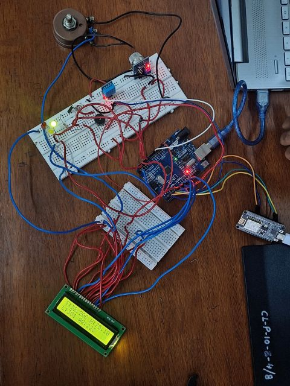
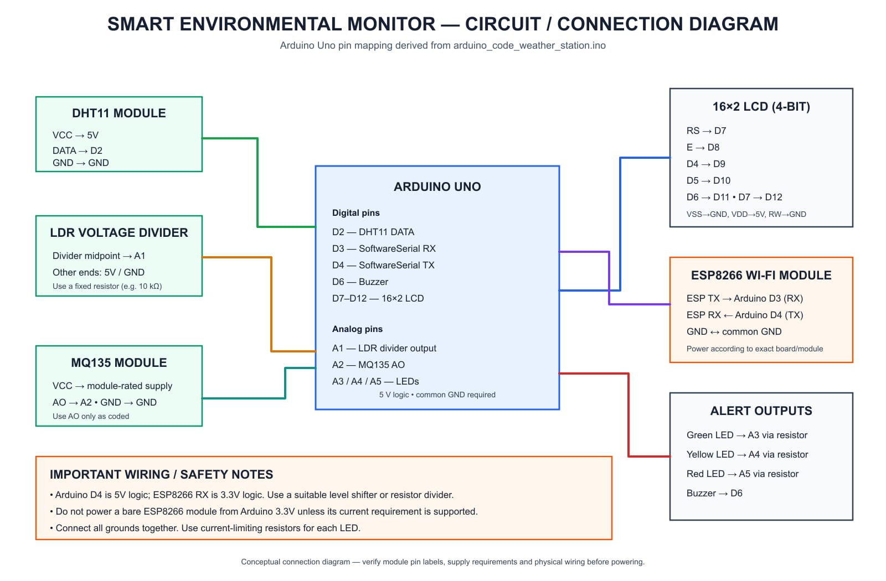
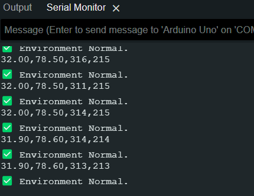
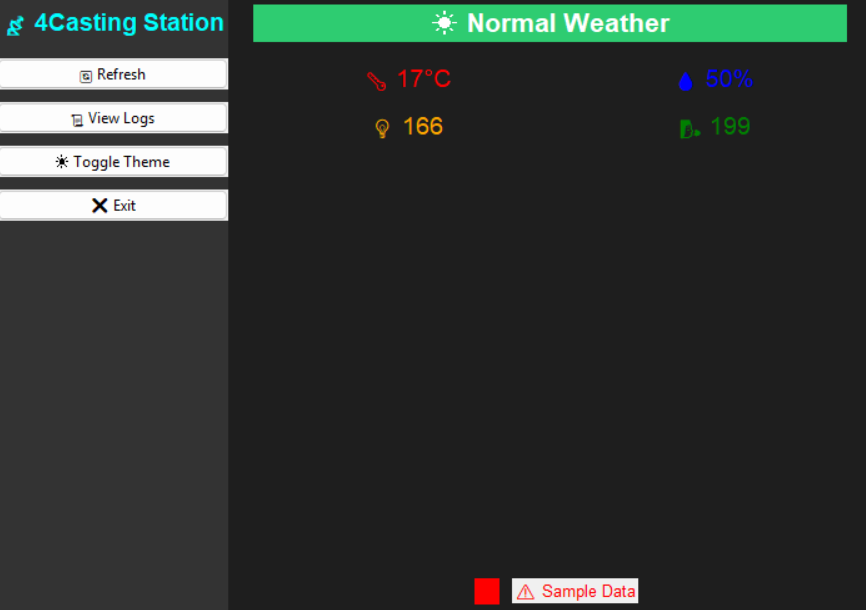
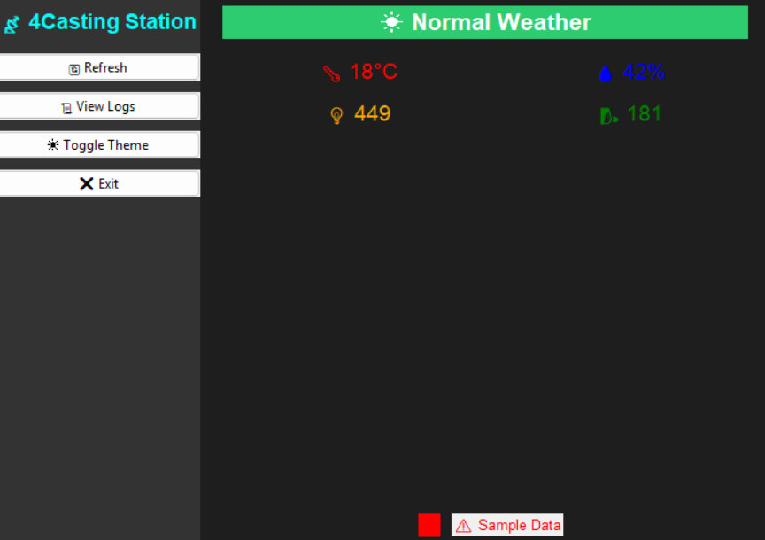

# 🌍 Smart Environmental Monitor with Computer-Based GUI

### An IoT-Based Environmental Monitoring System Using Arduino Uno, ESP8266 and Python

  <b>IoT | Embedded Systems | Sensor Interfacing | Python GUI | Wireless Communication</b>
</p>

---

## 📌 1. Project Overview

The **Smart Environmental Monitor** is an IoT-oriented environmental monitoring system developed during **Mackethon**, a pre-event of our department's technical fest, *Prominence*.

The project aims to monitor important environmental parameters such as temperature, humidity, light intensity and air-quality-related sensor readings using multiple sensors interfaced with an Arduino Uno.

An ESP8266 Wi-Fi module is incorporated for wireless communication. The collected readings are displayed locally through an LCD and are intended to be transmitted to a computer-based monitoring application.

A graphical user interface (GUI), developed using Python and Tkinter, provides a visual platform for monitoring environmental parameters. MQTT communication is implemented in the Python application for receiving environmental data.

The system also incorporates LEDs and a buzzer to provide visual and audible alerts under predefined environmental conditions.

## 🎯 2. Problem Statement

Monitoring multiple environmental parameters independently can be inconvenient and time-consuming.

This project aims to develop an integrated monitoring prototype that collects environmental data automatically, displays the readings through a graphical interface and provides alert indications when predefined threshold conditions are reached.

## 🎯 3. Objectives

- Measure temperature and humidity using a DHT11 sensor.
- Monitor surrounding light intensity using an LDR.
- Obtain air-quality-related readings using an MQ135 sensor.
- Interface multiple sensors with Arduino Uno.
- Display sensor readings on a 16×2 LCD.
- Implement visual and audible alerts using LEDs and a buzzer.
- Incorporate ESP8266-based wireless communication.
- Develop a computer-based GUI using Python Tkinter.
- Display and log environmental readings through the GUI.

## ⚙️ 4. Technologies Used

| Category | Technologies |
|---|---|
| Microcontroller | Arduino Uno |
| Wireless Module | ESP8266 |
| Programming Languages | Embedded C/C++, Python |
| GUI Development | Tkinter |
| Communication | Serial Communication, MQTT |
| Sensors | DHT11, LDR, MQ135 |
| Display | 16×2 LCD |
| Development Environment | Arduino IDE, Python IDE |

## 🔌 5. Hardware Components

| Component | Purpose |
|---|---|
| Arduino Uno | Main controller for sensor acquisition and output control |
| ESP8266 | Wi-Fi-enabled communication module |
| DHT11 | Measures temperature and humidity |
| LDR | Detects changes in light intensity |
| MQ135 | Provides gas-sensor readings for air-quality indication |
| 16×2 LCD | Displays environmental readings |
| Green LED | Indicates normal conditions |
| Yellow LED | Indicates warning conditions |
| Red LED | Indicates critical conditions |
| Buzzer | Provides audible alerts |
| Breadboard and Jumper Wires | Circuit connections and prototyping |

**Note:** The current Arduino source code is configured for DHT11, LDR and MQ135. LM35 and DHT22 are not included in the documented implementation.

## 💻 6. Software Requirements

- Arduino IDE
- Python 3
- Tkinter
- Paho-MQTT Python library
- MQTT Broker
- Required Python dependencies

## 🏗️ 7. System Architecture

The system consists of two main sections:

**Hardware Monitoring Unit**

Arduino Uno acquires readings from the environmental sensors, processes the values, updates the LCD and controls the alert indicators. The readings are also sent through serial communication to the ESP8266.

**Computer-Based Monitoring Unit**

The Python Tkinter application subscribes to an MQTT topic, receives environmental readings, displays them through the GUI and maintains timestamped logs.

### Data Communication Flow

```text
  ENVIRONMENTAL SENSORS
  ┌─────────────────────────────┐
  │ DHT11 | LDR | MQ135         │
  └──────────────┬──────────────┘
                 │
                 ▼
         ┌───────────────┐
         │  ARDUINO UNO  │
         │ Data Processing│
         └───────┬───────┘
                 │
          ┌──────┴──────┐
          ▼             ▼
      16×2 LCD     LEDs + Buzzer
                 │
                 ▼
           ESP8266 Wi-Fi
                 │
                 ▼
            MQTT Broker
                 │
                 ▼
        PYTHON TKINTER GUI
                 │
                 ▼
       Monitoring and Data Logs
```

*Note: The ESP8266-to-MQTT publishing firmware is a separate implementation requirement and should be included and verified for complete end-to-end wireless operation.*

## 🔄 8. Working Methodology

### Step 1: Sensor Data Acquisition

The DHT11 measures temperature and humidity, while the LDR and MQ135 provide analog sensor readings.

### Step 2: Data Processing

Arduino Uno processes the acquired sensor readings and prepares a formatted data string.

### Step 3: LCD Display

The readings are displayed locally on a 16×2 LCD.

### Step 4: Alert Generation

The Arduino compares sensor readings against predefined threshold values.

- 🟢 Green LED – Normal condition.
- 🟡 Yellow LED – Warning condition.
- 🔴 Red LED – Critical condition.
- 🔔 Buzzer – Audible alert.

### Step 5: Serial Communication

The Arduino transmits formatted sensor data to the ESP8266 through SoftwareSerial communication.

### Step 6: Computer-Based Monitoring

The Python Tkinter application provides a graphical interface for displaying environmental parameters.

MQTT is used for receiving messages through the configured environmental data topic.

### Step 7: Data Logging

The GUI records environmental readings with timestamps for monitoring purposes.

## ✨ 9. Key Features

- Multi-parameter environmental monitoring.
- Temperature and humidity measurement.
- Light intensity detection.
- Air-quality-related sensor monitoring.
- LCD-based local display.
- LED-based environmental status indication.
- Buzzer-based critical alerts.
- Serial communication with ESP8266.
- Python-based graphical monitoring interface.
- MQTT-based data reception.
- Timestamped data logging.
- GUI theme switching and log viewing.
- Sample-data mode for GUI demonstration when live data is unavailable.

## 📂 10. Repository Structure

```text
smart-environmental-monitor/
│
├── Arduino_Code/
│   ├── arduino_code_weather_station.ino
│   └── sketch_mar2a.ino
│
├── Python_GUI/
│   └── gui.py
│
├── Images/
│   ├── hardware-prototype.jpg
│   ├── arduino-serial-monitor.png
│   ├── gui-dashboard-sample-1.png
│   └── gui-dashboard-sample-2.png
│
├── Circuit_Diagrams/
│   └── smart_environmental_monitor_circuit_diagram.svg
│
├── Documentation/
│   └── Smart_Environmental_Monitor_Project_Report.pdf
│
├── Videos/
│
├── requirements.txt
└── README.md
```

## 🖼️ 11. Hardware Implementation


## 🖥️ 11. Hardware Implementation

### Hardware Prototype



The hardware prototype integrates the Arduino Uno, ESP8266, environmental sensors, LCD display, LEDs and buzzer for environmental monitoring.

### Circuit Diagram



The circuit diagram illustrates the sensor interfacing and connections with the Arduino Uno.

---

## 📊 12. Results and Output

### GUI Dashboard - Sample Output 1



### GUI Dashboard - Sample Output 2



### GUI Dashboard - Sample Output 3



---

## 📄 13. Project Documentation

[View Project Report (PDF)](Smart_Environmental_Monitor_Project_Report.pdf)


## 🧠 13. What I Learned

Working on this project provided practical experience in:

- Interfacing multiple sensors with Arduino Uno.
- Understanding digital and analog sensor readings.
- Embedded programming using Arduino IDE.
- Serial communication using SoftwareSerial.
- ESP8266-based wireless communication concepts.
- Python GUI development using Tkinter.
- MQTT communication and message handling.
- Real-time data visualization and logging.
- Hardware and software debugging.
- Collaborative problem-solving and teamwork.

## ⚠️ 14. Limitations

- DHT11 has limited accuracy compared with advanced temperature and humidity sensors.
- MQ135 readings require calibration for meaningful air-quality measurements.
- LDR readings depend on the voltage-divider configuration and ambient lighting.
- Fixed alert thresholds may not suit every environment.
- Live wireless communication requires verified ESP8266 MQTT publishing firmware.
- The current GUI uses sample readings when live MQTT data is unavailable.

## 🚀 15. Future Improvements

The project can be enhanced through:

1. Implementing reliable ESP8266-to-MQTT communication.
2. Cloud-based environmental data storage.
3. Historical data visualization using graphs.
4. Mobile application integration for remote monitoring.
5. Improved sensor calibration and measurement accuracy.
6. Integration of advanced air-quality sensors.
7. Automated notifications through email or mobile alerts.
8. Battery-powered portable operation.
9. Environmental trend analysis and prediction.
10. Web-based monitoring dashboard.

## 👩‍💻 16. Team Members

This project was developed collaboratively during Mackethon, a pre-event of Prominence.

- **[Nandana Nair](https://www.linkedin.com/in/nandana-nair-88431a2a6/)**
- **[Swetha Varghese](https://www.linkedin.com/in/swetha-varghese-25aa5328b/)**
- **[Gauri Luxmi R](https://www.linkedin.com/in/gauri-luxmi-r-/)**

## 📖 17. Installation and Execution

### Prerequisites

- Arduino IDE installed.
- Python 3 installed.
- Required hardware components.
- Python dependencies installed.

### Arduino Setup

1. Open Arduino IDE.
2. Navigate to `Arduino_Code/`.
3. Open the appropriate `.ino` file.
4. Select Arduino Uno as the board.
5. Select the correct COM port.
6. Install any required Arduino libraries.
7. Upload the program to Arduino Uno.

### Python GUI Setup

1. Install Python 3.
2. Open a terminal in the `Python_GUI` directory.
3. Install the required dependencies:

```bash
pip install -r requirements.txt
```

4. Run the application:

```bash
python gui.py
```

5. Configure the MQTT broker and topic according to the application settings.

**Note:** The GUI can demonstrate sample readings independently. Live monitoring requires a working MQTT data publisher and compatible message format.

## 📄 18. Project Documentation

For detailed information about the hardware implementation, circuit connections, methodology and technical details, refer to the project report in the `Documentation` folder.

## 🤝 19. Acknowledgements

We sincerely thank everyone who supported and guided us during the development of this project as part of Mackethon, a pre-event of Prominence.

This project provided a valuable opportunity to explore IoT, embedded systems, sensor interfacing and computer-based monitoring through practical implementation.

---

<p align="center">
  <b>Built with curiosity, collaboration and a passion for technology. 💡</b>
</p>

<p align="center">
  #IoT #EmbeddedSystems #Arduino #ESP8266 #Python #Tkinter #EnvironmentalMonitoring
</p>
